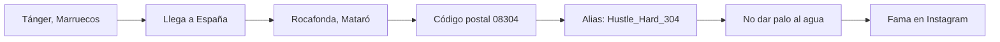
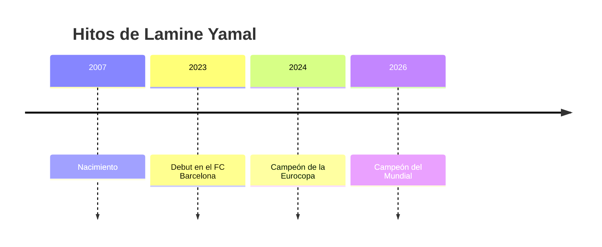
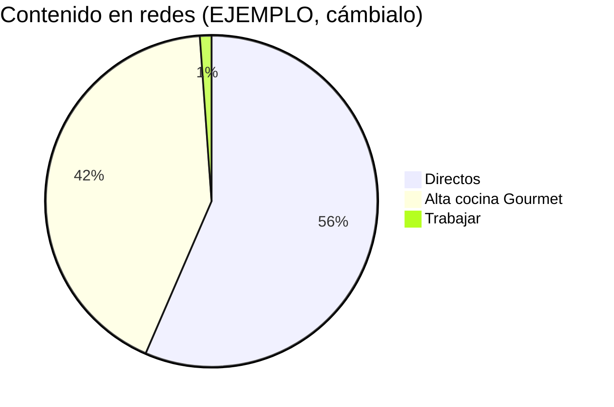
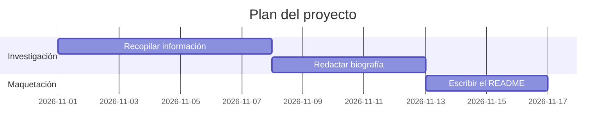
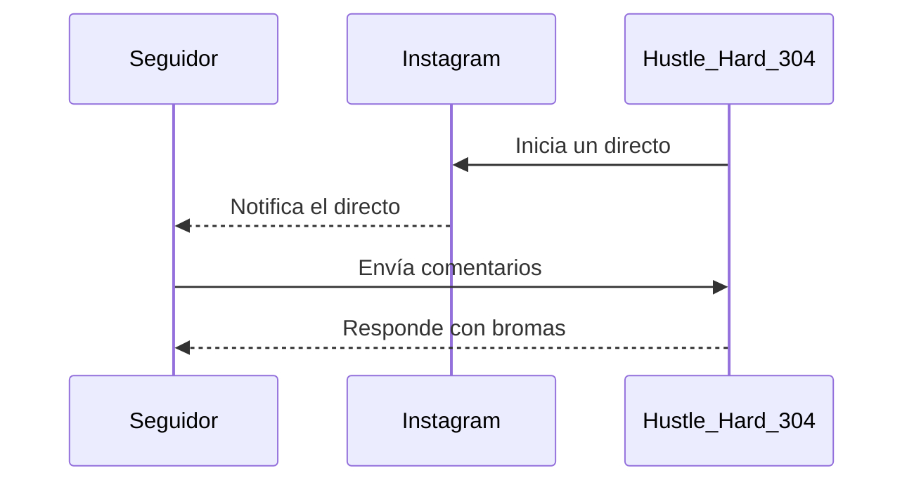
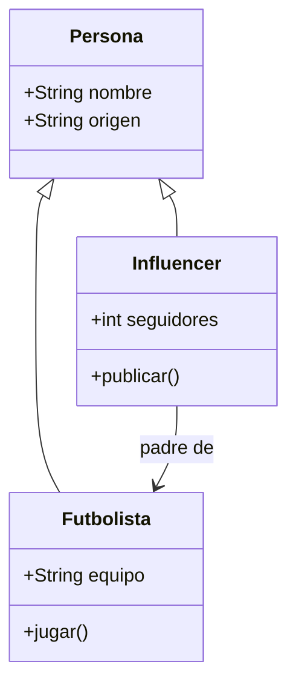

<!-- ======================================================= -->
<!-- README del proyecto: Hustle_Hard_304                     -->
<!-- Autor: Aday -->
<!-- ======================================================= -->

# <a id="inicio"></a>Hustle_Hard_304 🔥
[⬆️ Volver al índice](#indice "Ir al índice")

<div align="center">

  

  <h3>Una leyenda incomprendida</h3>
  <p><em>Este proyecto es una bibliografía de Hustle_Hard_304</em></p>

  
  

</div>

## <a id="indice"></a>📑 Índice

1. [Hustle_Hard_304](#inicio "Ir al inicio")
2. [Introducción](#introduccion "Ir a Introducción")
3. [Biografía](#biografia "Ir a Biografía")
4. [El hijo: Lamine Yamal](#hijo "Ir a El hijo")
5. [Presencia en redes](#redes "Ir a Presencia en redes")
6. [Datos y tablas](#tablas "Ir a Datos y tablas")
7. [Matemáticas](#matematicas "Ir a Matemáticas")
8. [Diagramas](#diagramas "Ir a Diagramas")
9. [Galería de imágenes](#galeria "Ir a Galería")
10. [Código](#codigo "Ir a Código")
11. [Lista de tareas](#tareas "Ir a Lista de tareas")
12. [Alertas y citas](#alertas "Ir a Alertas y citas")
13. [Enlaces y recursos](#enlaces "Ir a Enlaces y recursos")
14. [Conclusión](#conclusion "Ir a Conclusión")

---

# <a id="introduccion"></a>Introducción 📖
[⬆️ Volver al índice](#indice "Ir al índice")

## Una leyenda incomprendida

### Este proyecto es una bibliografía de Hustle_Hard_304

***Mounir Nasraoui***, mundialmente conocido como *Hustle_hard_304*,
nació en **Marruecos (Tánger)** y se radicó en España desde joven,
viviendo en el humilde barrio de Rocafonda en Mataró (Barcelona), cuyo
código postal (08304) inspiró el número **"304"** de su nombre en
redes. \
Cuenta con más de un **millón de seguidores** en Instagram, donde es
conocido por sus directos espontáneos, bromas, publicaciones
gastronómicas (como sus famosas recetas de tortilla de patata con
cebolla o nuggets de pollo) y reacciones sobre la carrera de su hijo.

----
~~Lamine Yamal~~ El hijo de ***hustle_hard_304***, es jugador de
fútbol profesional en el FC Barcelona.

### Formatos de texto

Aquí se muestran los distintos formatos: **negrita**, *cursiva*,
***negrita cursiva***, ~~tachado~~, `código en línea` y <mark>texto
resaltado</mark>.

Este es un segundo párrafo con saltos de línea.
Esta línea se separa con dos espacios al final.\
Esta otra se separa con una barra invertida.<br>
Y esta con una etiqueta HTML.

***

Y un tercer párrafo, separado del anterior por un separador horizontal.

---

# <a id="biografia"></a>Biografía 🧬
[⬆️ Volver al índice](#indice "Ir al índice")

## Orígenes

1. **Nacimiento**
   - Lugar: Tánger, Marruecos 🇲🇦
   - Llegada a España 🇪🇸 desde joven
2. **Vida en Mataró**
   - Barrio de Rocafonda
   - Código postal 08304 → origen del "304"
3. **Fama en redes**
   1. Directos espontáneos
   2. Recetas de cocina
   3. Reacciones a la carrera de su hijo

## Aspectos destacados

- 🍳 Gastronomía
  - Tortilla de patata con cebolla
  - Sopa de macarrones
  - Hustle nuggets de pollo
- 📱 Redes sociales
  * Instagram
  * Directos
  * ~~Linkedin~~
- 👨‍👦 Familia
  + Su hijo, futbolista profesional

---

# <a id="hijo"></a>El hijo: Lamine Yamal ⚽
[⬆️ Volver al índice](#indice "Ir al índice")

## Trayectoria deportiva

~~Lamine Yamal~~ El hijo de **hustle_hard_304** es jugador del **FC
Barcelona** y de la selección española.

### Hitos

- 2007: nacimiento en Esplugues de Llobregat (Barcelona)
- 2023: debut con el primer equipo del FC Barcelona
- 2024: campeón de la Eurocopa con España
- 2026: campeón del Mundial con España

#### Más datos

Consulta su perfil en el [sitio oficial del FC
Barcelona](https://www.fcbarcelona.com "Web oficial del FC Barcelona")
o en [Wikipedia](https://es.wikipedia.org/wiki/Lamine_Yamal "Lamine
Yamal en Wikipedia").

##### Nivel 5 de encabezado

Este es un encabezado de nivel 5.

###### Nivel 6 de encabezado

Y este es el último nivel de encabezado que existe.

---

# <a id="redes"></a>Presencia en redes 📱
[⬆️ Volver al índice](#indice "Ir al índice")

<details>
<summary><b>👉 Pulsa para desplegar el contenido</b></summary>


- Instagram: más de **1 millón** de seguidores
- Contenido: directos, bromas y cocina
- Atajo de teclado de ejemplo: <kbd>Ctrl</kbd> + <kbd>C</kbd>

</details>

## Elementos HTML

<table>
  <tr>
    <th>Plataforma</th>
    <th>Tipo de contenido</th>
  </tr>
  <tr>
    <td>Instagram</td>
    <td>Directos y publicaciones</td>
  </tr>
</table>

<p align="center">
  <b>Texto centrado</b> con H<sub>2</sub>O (subíndice) y x<sup>2</sup>
(superíndice).
</p>

<!-- Recuerda: GitHub no admite el atributo style, por eso se usa align -->

---

# <a id="tablas"></a>Datos y tablas 📊
[⬆️ Volver al índice](#indice "Ir al índice")

## Tabla 1: ficha personal (alineación a la izquierda)

| Campo         | Valor                    |
| :------------ | :----------------------- |
| Nombre        | Mounir Nasraoui          |
| Alias         | Hustle_Hard_304          |
| Origen        | Tánger, Marruecos        |
| Barrio        | Rocafonda (Mataró)       |

## Tabla 2: redes (alineación centrada)

| Plataforma | Estado | Contenido  |
| :--------: | :----: | :--------: |
| Instagram  |   ✅   | Directos   |
| INFOJOBS    |   ❌   | Vacío     |
| LINKEDIN    |   ❌   | Vacío     |

## Tabla 3: plan del proyecto (mezcla de alineaciones)

| Sección (izq.)  | Estado (centro) | Horas (der.) |
| :-------------- | :-------------: | -----------: |
| Investigación   | ✅ Completada   |          5.0 |
| Redacción       | 🔄 En curso     |         10.5 |
| Revisión final  | ⏳ Pendiente    |          2.0 |

---

# <a id="matematicas"></a>Matemáticas ➗
[⬆️ Volver al índice](#indice "Ir al índice")

> [!NOTE]
> Todos los datos de esta sección son **inventados** y están pensados solo
> para practicar LaTeX. Cualquier parecido con la realidad es pura coincidencia. 😄

## 📐 Geometría: el ángulo de la barba

La barba de Hustle_Hard_304 tiene una longitud $h$ y una semianchura $b$ en la
base. Su ángulo de apertura se calcula con $\theta = \arctan\left(\frac{h}{b}\right)$,
donde $\overline{AB}$ es el segmento que va de la barbilla a la patilla.

Con $h = 8\ \text{cm}$ y $b = 3\ \text{cm}$:

$$\theta = \arctan\left(\frac{8}{3}\right) \approx 69{,}4^\circ$$

## 🥚 Aritmética y combinatoria: la tortilla de mil kilos

Si se usan 6 huevos por cada kilo de patatas, para una tortilla de 1000 kg
hacen falta:

$$N_{\text{huevos}} = \frac{6\ \text{huevos}}{1\ \text{kg}} \times 1000\ \text{kg} = 6000\ \text{huevos} = 500\ \text{docenas}$$

Y, por si acaso, las formas de elegir 6 huevos de una caja de 12 son
$\binom{12}{6} = 924$.

## 🍳 Geometría 2: el tamaño de la sartén

Suponiendo una tortilla de $V = 1\ \text{m}^3$ (densidad similar a la del agua)
y una altura $h = 0{,}1\ \text{m}$, el radio de la sartén sería:

$$V = \pi r^2 h \;\Rightarrow\; r = \sqrt{\frac{V}{\pi h}} = \sqrt{\frac{1}{0{,}1\pi}} \approx 1{,}78\ \text{m}$$

## 🍜 Álgebra: la sopa de macarrones

Queremos 1000 g de sopa, con $x$ gramos de macarrones e $y$ gramos de agua,
y que haya 9 veces más agua que macarrones:

$$
\begin{cases}
x + y = 1000 \\
y = 9x
\end{cases}
\quad \Rightarrow \quad
\begin{cases}
x = 100\ \text{g} \\
y = 900\ \text{g}
\end{cases}
$$

## 🧱 Álgebra lineal: la lista de la compra

La matriz $A$ indica los ingredientes que necesita cada plato (tortilla por kg y
sopa por litro) y el vector $\vec{p}$ los platos que se preparan:

$$
\underbrace{
\begin{bmatrix}
6 & 0 \\
1 & 0 \\
0 & 0{,}1
\end{bmatrix}
}_{A}
\underbrace{
\begin{pmatrix}
1000 \\
20
\end{pmatrix}
}_{\vec{p}}
=
\begin{pmatrix}
6000 \\
1000 \\
2
\end{pmatrix}
\quad
\begin{matrix}
\text{huevos} \\
\text{kg de patatas} \\
\text{kg de macarrones}
\end{matrix}
$$

## 🛢️ Cálculo: el aceite para freír

Si el consumo de aceite (en litros por minuto) crece con el tiempo según
$r(t) = 0{,}5 + 0{,}1t$, el aceite gastado en 10 minutos es:

$$\int_0^{10} (0{,}5 + 0{,}1t)\,dt = \left[ 0{,}5t + 0{,}05t^2 \right]_0^{10} = 5 + 5 = 10\ \text{litros}$$

Y cuantos más invitados $n$ haya, menos tortilla toca a cada uno:
$\lim_{n \to \infty} \frac{1000}{n} = 0\ \text{kg}$.

## 🧺 Teoría de conjuntos: el menú

Sean $A = \{\text{tortilla}, \text{nuggets}\}$ y $B = \{\text{nuggets}, \text{sopa}\}$.
Entonces:

$$A \cap B = \{\text{nuggets}\} \qquad A \cup B = \{\text{tortilla}, \text{nuggets}, \text{sopa}\}$$

Y, como el trabajo y el *joseo* no se mezclan, $\text{Linkedin} \cap \text{Trabajo} = \emptyset$.

## 💶 Ecuaciones alineadas: el presupuesto

Con huevos a $0{,}25\ \text{€}$ y patatas a $1{,}20\ \text{€/kg}$ (precios inventados):

$$
\begin{aligned}
C &= 6000 \cdot 0{,}25 + 1000 \cdot 1{,}20 \\
  &= \underbrace{1500}_{\text{huevos}} + \underbrace{1200}_{\text{patatas}} \\
  &= 2700\ \text{€}
\end{aligned}
$$

---

# <a id="diagramas"></a>Diagramas 🧩
[⬆️ Volver al índice](#indice "Ir al índice")

## Diagrama de flujo



## Línea de tiempo



## Diagrama de sectores (datos de ejemplo)



## Diagrama de Gantt



## Diagrama de secuencia



## Diagrama de clases




---

# <a id="codigo"></a>Código 💻
[⬆️ Volver al índice](#indice "Ir al índice")

## Código en línea

Para ver el proyecto usa `git clone` y después abre el archivo `README.md`.

## Python: crecimiento de seguidores

```python
def seguidores(f0, r, t):
    """Calcula los seguidores tras t periodos."""
    return f0 * (1 + r) ** t

print(seguidores(1_000_000, 0.05, 3))
```

## Bash: comandos Git

```bash
git add README.md
git commit -m "Añado README del proyecto"
git push origin main
```

## JSON: ficha de datos

```json
{
  "nombre": "Mounir Nasraoui",
  "alias": "Hustle_Hard_304",
  "origen": "Tánger, Marruecos",
  "codigo_postal": "08304"
}
```

## HTML: estructura básica

```html
<!DOCTYPE html>
<html lang="es">
  <head><title>Hustle_Hard_304</title></head>
  <body><h1>Una leyenda incomprendida</h1></body>
</html>
```

---

# <a id="tareas"></a>Lista de tareas ✅
[⬆️ Volver al índice](#indice "Ir al índice")

## Tareas del proyecto

- [x] Crear el repositorio
- [x] Escribir la introducción
- [x] Añadir tablas y diagramas
- [x] Añadir citas verificadas
- [ ] Revisar ortografía y enlaces

---

# <a id="alertas"></a>Alertas y citas 🚨
[⬆️ Volver al índice](#indice "Ir al índice")

## Alertas

> [!NOTE]
> Información útil que conviene tener en cuenta al leer el documento.

> [!TIP]
> Consejo: usa el índice para moverte rápidamente entre secciones.

> [!IMPORTANT]
> Este documento es una bibliografía y debe basarse en fuentes fiables.

> [!WARNING]
> Verifica siempre los datos antes de publicarlos.

> [!CAUTION]
> Evita incluir información privada o no contrastada.

## Citas en bloque

> "Lamine Yamal, para bien o para mal... No esta nada mal. Ey chaval, que es la que hay."
>
> — **hustle_hard_304**, 20 de octubre 2026.


---

# <a id="enlaces"></a>Enlaces y recursos 🔗
[⬆️ Volver al índice](#indice "Ir al índice")

## Enlaces externos

- [Guía de Markdown de
GitHub](https://docs.github.com/es/get-started/writing-on-github
"Documentación oficial de GitHub")
- [Alertas de Markdown](https://markdown.land/markdown-alerts
"Información sobre alertas")
- [Documentación de Mermaid](https://mermaid.js.org "Sitio oficial de Mermaid")
- [Instagram](https://www.instagram.com "Ir a Instagram")


## Enlaces internos

- Ir a [Introducción](#introduccion "Ir a Introducción")
- Ir a [Diagramas](#diagramas "Ir a Diagramas")
- Ir al [índice](#indice "Volver al índice")


---

# <a id="conclusion"></a>Conclusión 🏁
[⬆️ Volver al índice](#indice "Ir al índice")

**Hustle_Hard_304** es una figura muy conocida en redes sociales gracias a su
carácter espontáneo y cercano. 🎉

Este proyecto recopila su historia, su entorno y su vinculación con la carrera
de su hijo, ~~Lamine Yamal~~, utilizando todas las posibilidades de Markdown.

<div align="center">

  ⭐ **¡Gracias por leer!** ⭐

  [⬆️ Volver al inicio](#inicio "Ir al inicio") · [📑 Ir al
índice](#indice "Ir al índice")

</div>
